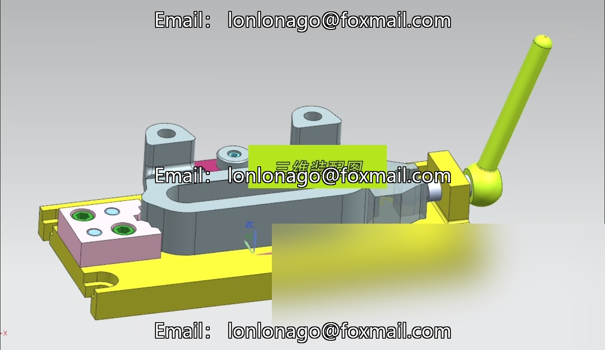
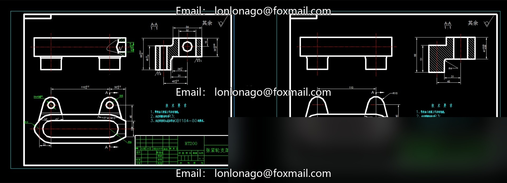
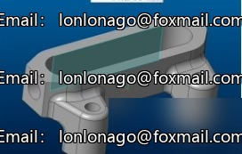
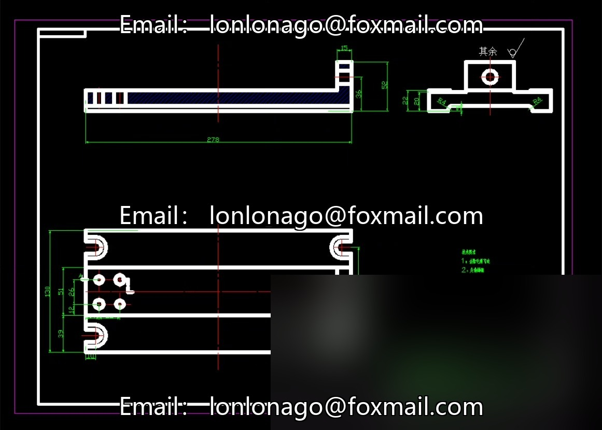
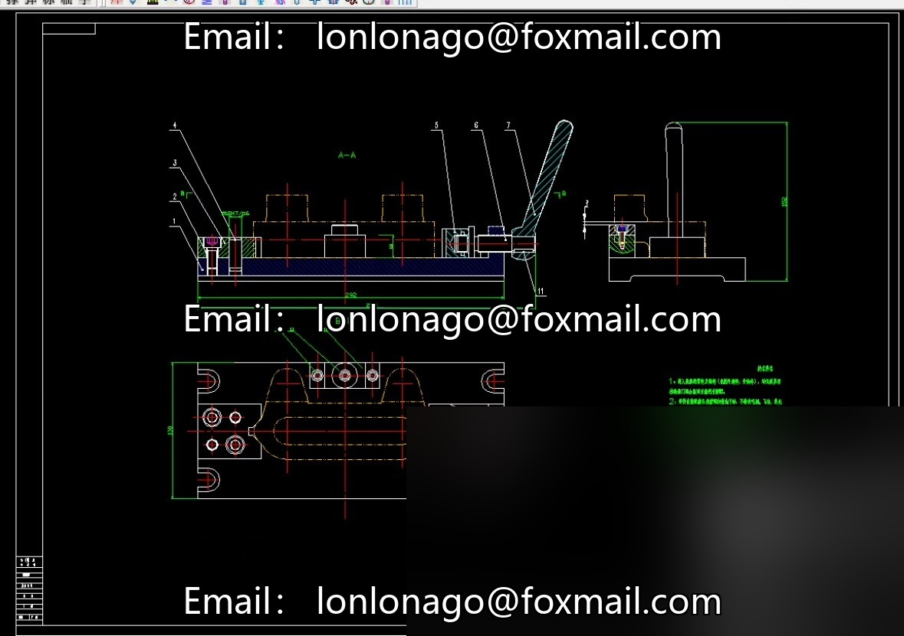
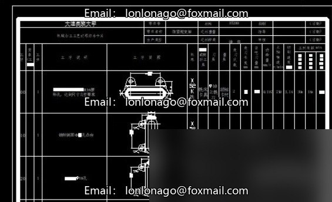

# Armored wheel bracket fixture design - milling end surface

## Body

Tensile Ring Bracket Fixture Design - Bevel End; 143 Tensile Ring Bracket Fixture Design - Bevel End (including 3D, 3D figures, 2D figures, instructions, process cards, Tensile Ring Bracket is a very important part because its part size is relatively small, structure and shape are relatively complex, but its machining holes and bottom precision requirements are high, in addition, the end requires machining of the small end hole, and the precision requirements are also high.

The design focuses on milling an end face for a tension wheel support fixture, with the figures showing 3D assembly, technical parameters and process cards.

<!-- AI_ENRICHED -->

## Images

## Payment

Here is a pay link on Stripe ( https://buy.stripe.com/3cs8yP7sY87d0vu9AB ). Please contact me lonlonago@foxmail.com after funding $89, and I will send you a complete data files , thank you!

